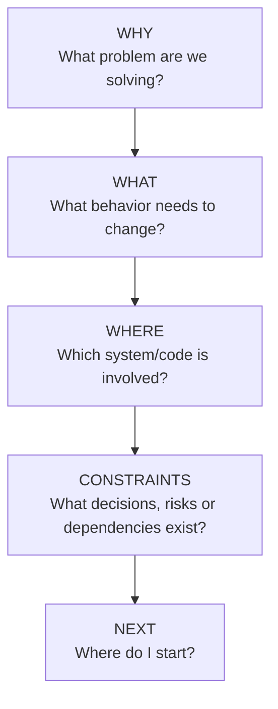
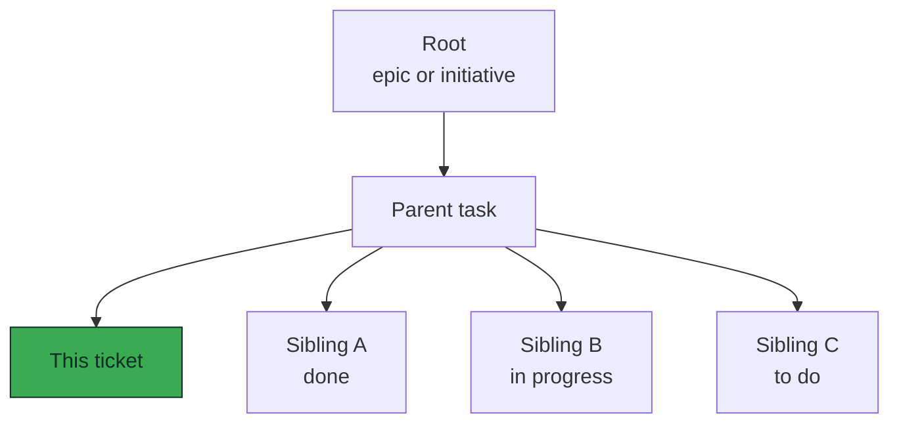
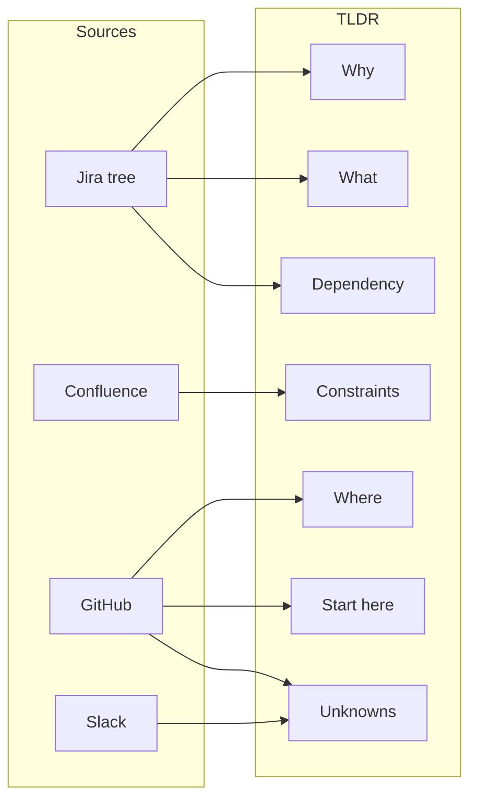
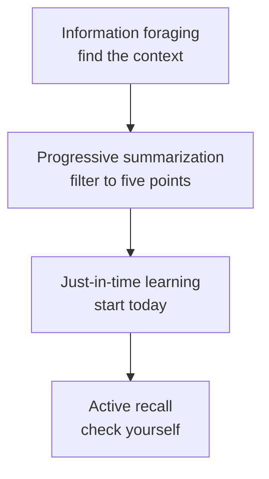

# Dev TLDR: output format

Dev TLDR turns a Jira ticket into a one-page briefing a developer can read in under a minute. It does not summarize the ticket. It reconstructs the context around it by walking the ticket tree and following references to it in Confluence, GitHub and Slack.

This document defines what the briefing contains and why.

---

## 1. The idea: five questions

Every briefing answers the same five questions, in this order. A developer who has the answers can start working.



| Question | Section in the TLDR | Where the answer usually comes from |
| --- | --- | --- |
| Why | Point 1 | Ticket, parent and root descriptions |
| What | Point 2 | Ticket description, acceptance criteria, sibling tasks |
| Where | Point 3 | PRs, branches, files touched |
| Constraints | Points 4 and 5 | ADRs, SDRs, comments, linked tickets |
| Next | Start here | The most recent PR or the first open task |

---

## 2. How it works

The skill runs as a tree search. It starts at the ticket, climbs to the root, walks down through every branch to see how the whole piece of work is evolving, and only then looks for references in other tools. The ticket key is how the skill is invoked; the searches come from the tree it opens: every tree key, plus the terms, modules and people its tickets mention.

```mermaid
flowchart LR
    IN(["Ticket<br/>PAY-123"]) --> J
    subgraph S1["1. Jira: build the tree"]
        J["Read the ticket"] --> UP["Go up to the root"]
        UP --> DOWN["Go down through siblings<br/>and children, with status"]
    end
    DOWN --> C
    subgraph S2["2. Confluence"]
        C["Read linked pages<br/>and comments"] --> CK["Search each key"]
    end
    CK --> G
    subgraph S3["3. GitHub"]
        G["PRs and branches by key"] --> GC["Review comments<br/>and PR state"]
    end
    GC --> SL
    subgraph S4["4. Slack"]
        SL["Search each key"] --> ST["Read full threads"]
    end
    ST --> OUT(["TLDR"])
```



Each phase uses what the previous one found: new keys, content terms, page URLs and PR links are passed forward. Confluence and GitHub run side by side after Jira; Slack runs last and receives everything they found.

### The tree it walks



Reading the siblings answers questions the ticket cannot: what is already decided, what is in flight, and what depends on this work.

### From sources to sections



---

## 3. Output template

This is the file the skill writes, as `tldr-<TICKET-KEY>.md`.

````md
# TLDR: PAY-123 — External payroll access
Confidence: High · Generated 2026-10-21

## Where this sits
PAY-100 Payroll integration (In progress)
└ PAY-120 Expose payroll data through an API (In progress)
   ├ **PAY-123 External payroll access (In code review)**  ← this ticket
   ├ PAY-121 Generate design record (Released)
   └ PAY-124 Add response mapper (To do)

1. **Why** — External clients need access to approved payroll data. ([source](url), Author, 2026-09-28)
2. **What** — The API must expose... ([source](url), Author, 2026-09-28)
3. **Where** — The change affects `PayrollDataService` and... ([source](url), Author, 2026-10-02)
4. **Constraints** — Only approved/locked payrolls... ([source](url), Author, 2026-06-29)
5. **Dependency** — Authentication depends on... ([source](url), Author, 2026-10-05)

## Unknowns

* [open] Expected behaviour when no locked payroll exists?
* [possible] PR #812 appears related but does not reference PAY-123.

## Start here
`PayrollDataService#getLatestPayroll()` — implementation referenced by PR #790.

## Links

* [Ticket PAY-123](url): the ticket
* [ADR: payroll access](url): decision on hosting
* [PR #790](url): current implementation

## Coverage

* Jira: ticket + 12 comments; tree: root PAY-100, 5 nodes read
* Confluence: 2 relevant pages
* GitHub: 3 PRs
* Slack: no results for "PAY-123"

## Check yourself

* Why is this change needed?
* Where does the implementation live?
* What remains unresolved?
````

---

## 4. Section guide

| Section | What goes in it | Rules |
| --- | --- | --- |
| Header | Ticket key, title, confidence, date | Confidence is High when two or more independent sources agree, Medium for one solid source, Low when evidence is thin, outdated or conflicting. |
| Where this sits | The ticket tree with status per node and one line on how the work is evolving | One line per node, about 12 lines at most. Collapse the rest as a count. |
| Points 1 to 5 | Why, What, Where, Constraints, Dependency | Maximum five. Five is a ceiling, not a quota: skip a point when there is no evidence. Each point ends with a source link, author and date. |
| Unknowns | What the evidence does not settle | `[open]` for a missing answer, `[possible]` for a concrete lead without an explicit link, `[inference]` for something deduced. Never include something because it sounds related. |
| Start here | The first concrete step | A real file, method or PR taken from a source, never a guess. |
| Links | Three to six links that matter | One short reason per link. |
| Coverage | What was searched and found, per source | Never omitted. Lists nodes read and not read, keys with no results, and anything that failed. |
| Check yourself | Three questions to answer from memory | Answer them before reading the TLDR a second time. |

---

## 5. Rules that keep it trustworthy

1. **Evidence only.** Every point comes from something retrieved. No source, no point.
2. **Anchored to the tree.** Sources count only if they cite a key in the ticket tree, are linked from one of its tickets, or match its content on at least two concrete points (a distinctive term from a ticket's text, the same people, the same artifact, the same time window). The tie is stated in the finding. A topic-only match goes to Unknowns as `[possible]`.
3. **Short.** About 250 words for the points and unknowns.
4. **Contradictions are shown.** If a later comment overrides the description, or a PR state disagrees with the Jira status, both are reported with dates.
5. **Stale items are flagged.** Sources older than six months are marked as possibly outdated. Phrases like "tomorrow" are only valid relative to their own date.
6. **Read-only.** The skill never creates, edits or comments on anything.
7. **Gaps are visible.** Empty results are reported in Coverage, never filled from general knowledge.

---

## 6. Why it is designed this way

The design combines four established techniques.

| Technique | Role in the skill |
| --- | --- |
| Information foraging | Finds context by opening the ticket and following its tree and content through Jira, Confluence, GitHub and Slack. |
| Progressive summarization | Filters everything found down to five evidence-backed points. |
| Just-in-time learning | Keeps only what is needed to start this ticket today. |
| Active recall | `Check yourself` makes the reader reconstruct the answer instead of rereading. |



> Dev TLDR applies just-in-time learning through evidence-backed progressive summarization, using information foraging for context discovery and active recall for comprehension.

---

## 7. Status against the current skill

The saved `dev-tldr` skill now follows this format. Not yet in the skill:

* The Feynman step (explain in one sentence why the change is needed) is an idea, not part of the format.
